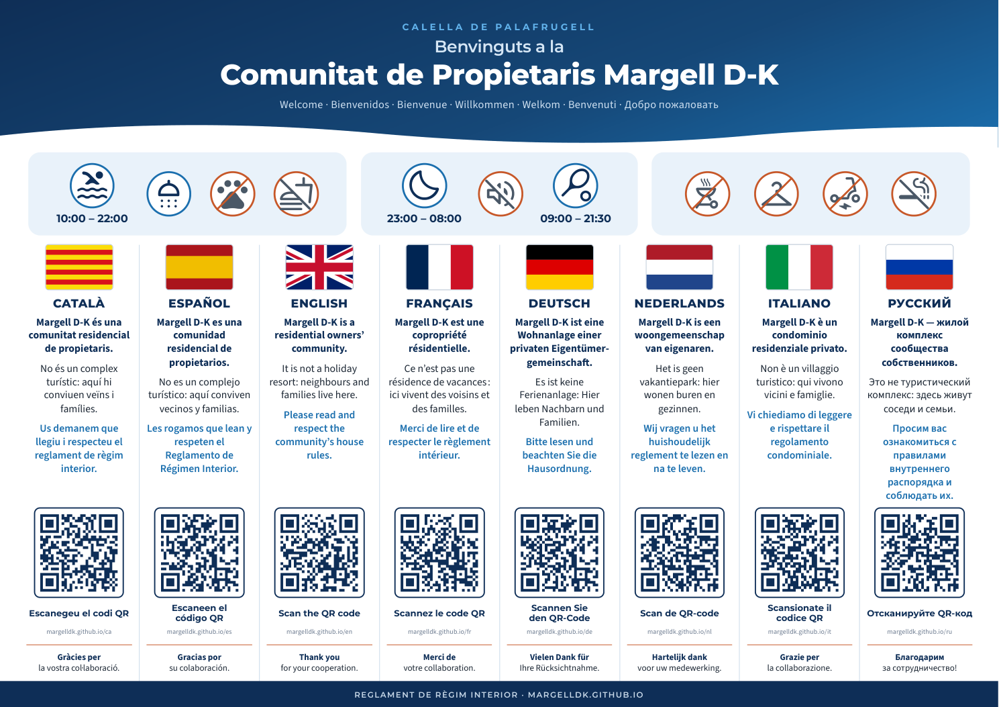

<div align="center">

# Margell D-K · reglament de règim interior

**Comunitat de Propietaris Margell D-K · Calella de Palafrugell**

El reglament de règim interior de la comunitat en **vuit llengües**: una web adaptada al mòbil i un cartell DIN A3 amb codis QR.

[🌐 Obre la web](https://margelldk.github.io) · [📄 Descarrega el cartell (PDF)](https://margelldk.github.io/cartell/Cartell_Margell_DK_A3.pdf) · [🖼️ Previsualització](cartell/previsualitzacio.png)



</div>

---

## Índex

1. [Per què existeix aquest projecte](#per-què-existeix-aquest-projecte)
2. [Enllaços directes](#enllaços-directes)
3. [El cartell DIN A3](#el-cartell-din-a3)
4. [La web](#la-web)
5. [Textos i traduccions](#textos-i-traduccions)
6. [Estructura del repositori](#estructura-del-repositori)
7. [Com actualitzar-ho pas a pas](#com-actualitzar-ho-pas-a-pas)
8. [Normes de manteniment](#normes-de-manteniment)
9. [Detalls tècnics](#detalls-tècnics)
10. [Crèdits](#crèdits)

---

## Per què existeix aquest projecte

Margell D-K és una **comunitat residencial de propietaris**, no un complex turístic. Molts dels qui hi passen temporades són llogaters o convidats que no parlen català. Perquè la convivència sigui bona, tothom ha de poder llegir les normes en la seva llengua.

El projecte té dues peces:

| Peça | Funció |
|---|---|
| **Cartell DIN A3** | Es penja en espais comuns. Dona la benvinguda, transmet un missatge de convivència amable en vuit llengües i, amb un QR per llengua, porta al reglament complet. |
| **Web** | Mostra el reglament sencer en la llengua triada. Es llegeix bé al mòbil, es pot imprimir i inclou els contactes de l'administració. |

---

## Enllaços directes

Aquestes són les adreces on porten els codis QR del cartell:

| Llengua | Títol del document | Adreça |
|---|---|---|
| 🟨🟥 Català | Reglament de règim interior | <https://margelldk.github.io/ca/> |
| 🇪🇸 Español | Reglamento de Régimen Interior | <https://margelldk.github.io/es/> |
| 🇬🇧 English | House Rules | <https://margelldk.github.io/en/> |
| 🇫🇷 Français | Règlement intérieur | <https://margelldk.github.io/fr/> |
| 🇩🇪 Deutsch | Hausordnung | <https://margelldk.github.io/de/> |
| 🇳🇱 Nederlands | Huishoudelijk reglement | <https://margelldk.github.io/nl/> |
| 🇮🇹 Italiano | Regolamento condominiale | <https://margelldk.github.io/it/> |
| 🇷🇺 Русский | Правила внутреннего распорядка | <https://margelldk.github.io/ru/> |

La portada, <https://margelldk.github.io>, permet triar la llengua i descarregar el cartell.

---

## El cartell DIN A3

📄 **Fitxer:** [`cartell/Cartell_Margell_DK_A3.pdf`](cartell/Cartell_Margell_DK_A3.pdf) (DIN A3 apaïsat, 420 × 297 mm)

### Contingut

1. **Capçalera:** «Benvinguts a la Comunitat de Propietaris Margell D-K» i la benvinguda en les altres set llengües.
2. **Franja de pictogrames.** Són normes clau expressades amb icones i horaris, sense text, perquè s'entenguin en qualsevol llengua:
   - 🏊 piscina de 10.00 a 22.00 h · 🚿 dutxa obligatòria · 🐾 sense animals · 🍽️ sense menjar
   - 🌙 descans de 23.00 a 8.00 h · 🔇 silenci · 🎾 pistes de 9.00 a 21.30 h
   - prohibit: barbacoes, roba a les baranes, vehicles elèctrics i fumar a les zones indicades
3. **Vuit columnes**, una per llengua, cadascuna amb:
   - la bandera i el nom de la llengua;
   - un missatge de tres frases: «és una comunitat residencial de propietaris», «no és un complex turístic: aquí hi conviuen veïns i famílies» i «llegiu i respecteu el reglament»;
   - el **codi QR**, que porta a la pàgina d'aquella llengua, amb l'adreça escrita a sota;
   - un agraïment.

### Recomanacions d'impressió

- Imprimiu-lo a **mida real (100 %)**, en DIN A3 i en color. No activeu «Ajusta a la pàgina».
- El paper mat evita reflexos a l'hora d'escanejar els QR. A l'exterior, plastifiqueu-lo.
- Abans d'imprimir-ne diverses còpies, **feu-ne una prova i escanegeu els vuit QR amb el mòbil**.
- Els QR fan 38 mm i tenen correcció d'errors de nivell M, de manera que es llegeixen bé encara que el cartell estigui una mica malmès.

---

## La web

### Què hi ha a cada pàgina de llengua

- **Selector d'idiomes** fix a la part superior, per canviar de llengua en qualsevol moment.
- **Capçalera** amb els logotips de l'administració (GiScom, API i Administrador de Finques Col·legiat).
- **Presentació** de la comunitat i petició de respecte al reglament.
- **Avís de traducció** (en totes les llengües excepte el català): en cas de discrepància, preval la versió catalana.
- **Normes clau**: sis targetes amb la piscina, les hores de descans, les pistes, els animals, les barbacoes i la roba estesa.
- **Els 21 articles**, numerats, cadascun amb un títol descriptiu i una icona.
- **Botó d'imprimir**, amb un full d'estil d'impressió en A4 a dues columnes.
- **Peu** amb els contactes de l'administració: adreça, telèfon, urgències, correu i web.

### Qualitat

| Aspecte | Com es resol |
|---|---|
| 📱 Adaptació a pantalles | Disseny fluid des de 320 px fins a pantalla gran, sense desplaçament horitzontal. Al mòbil, una columna; a l'ordinador, articles a dues columnes. |
| 🔤 Tipografia | Montserrat i Source Sans 3, amb suport complet per a l'alfabet ciríl·lic. |
| ✍️ Polit tipogràfic | Apòstrofs tipogràfics (’), espais fins abans de « : ; ! ? » en francès i espais no separables a «300 €», «10 h», etc. |
| ♿ Accessibilitat | Atribut `lang` correcte a cada pàgina i enllaç, enllaç per saltar al contingut, contrast alt i text alternatiu als logotips. |
| 🔎 Cercadors | Etiquetes `hreflang` entre les vuit versions i descripció pròpia per a cada pàgina. |
| 🔗 Enllaços a articles | Cada article té una àncora pròpia, per exemple <https://margelldk.github.io/ca/#article-7>. |

---

## Textos i traduccions

### Origen

El text de partida és el *Reglament de règim interior · Margell D-K* en català que va lliurar l'administració de la comunitat (DR GiScom S.L.). Té 21 articles.

### Correccions del text català

Abans de traduir, s'ha revisat el text original. **No s'ha canviat el contingut de cap norma.**

| Article | Original | Revisat |
|---|---|---|
| 1 | «les persones en què aquests deleguin» | «les persones en qui aquests deleguin» |
| 5 | Unes cometes de tancament que sobraven al final | Eliminades |
| 6, 12 | «número» de persones | «nombre» de persones |
| 8 | «al marxar» | «en marxar» |
| 11 | «En cas cap es fot circular amb transport elèctric» | «En cap cas no es pot circular amb vehicles elèctrics» |
| 17 | «dóna» | «dona» (ortografia del 2017) |
| 19 | «Qualsevol propietari […] seran responsables» | «Qualsevol propietari […] és responsable» |
| Diversos | «10h a 22h», «23:00h», «300€» | «de 10 a 22 h», «les 23 h», «300 €» |

### Criteris de traducció

- Les traduccions són **completes i fidels**: no se suprimeix ni s'afegeix cap obligació.
- Cada llengua fa servir la **terminologia pròpia de la propietat horitzontal** del seu àmbit:

| Llengua | Document | «Junta de propietaris» | «Espais comuns» |
|---|---|---|---|
| Español | Reglamento de Régimen Interior | junta de propietarios | espacios comunes |
| English (britànic) | House Rules | owners' meeting | common areas |
| Français | Règlement intérieur | assemblée des copropriétaires | parties communes |
| Deutsch | Hausordnung | Eigentümerversammlung | Gemeinschaftsbereiche |
| Nederlands | Huishoudelijk reglement | vergadering van eigenaren | gemeenschappelijke ruimten |
| Italiano | Regolamento condominiale | assemblea dei proprietari | spazi comuni |
| Русский | Правила внутреннего распорядка | общее собрание собственников | места общего пользования |

- Els **horaris** segueixen la convenció de cada país: «10 am – 10 pm» en anglès, «21 h 30» en francès, «21:30 Uhr» en alemany, «21.30 uur» en neerlandès, etc.
- Els **títols dels articles** no són al document original. S'hi han afegit per facilitar la lectura i no tenen valor normatiu.
- **El text que fa fe és el català.** Cada traducció ho indica explícitament.

---

## Estructura del repositori

```
margelldk.github.io/
├── index.html                  ← portada amb el selector de llengües (generada)
├── ca/ es/ en/ fr/ de/ nl/ it/ ru/
│   └── index.html              ← reglament en cada llengua (generades)
├── assets/
│   ├── estil.css               ← disseny de la web
│   ├── flags/                  ← banderes en SVG
│   └── img/                    ← logotips de l'administració
├── cartell/
│   ├── Cartell_Margell_DK_A3.pdf   ← cartell final, per imprimir (generat)
│   └── previsualitzacio.png        ← imatge del cartell per a aquest README
├── eines/
│   ├── textos.py               ← ✏️ TOTS ELS TEXTOS (8 llengües). L'únic fitxer que cal editar.
│   ├── genera.py               ← generador de la web, el cartell i el PDF
│   ├── cartell.css             ← disseny del cartell
│   └── cartell.html            ← cartell en HTML (generat)
├── esborranys/                 ← 🔒 documents originals i notes (només en local, no es publica mai)
├── 404.html                    ← redirigeix a la portada qualsevol adreça inexistent
└── README.md
```

> ⚠️ Els fitxers marcats com a *generats* es tornen a crear cada vegada que s'executa `genera.py`. **No els editeu a mà**, perquè els canvis es perdrien.

---

## Com actualitzar-ho pas a pas

### Requisits (només el primer cop)

- [Python 3](https://www.python.org/downloads/) i la llibreria per generar els QR:
  ```bash
  pip install qrcode
  ```
- Google Chrome o Microsoft Edge, que serveixen per crear el PDF.
- [Git](https://git-scm.com/) i accés d'escriptura a l'organització [`margelldk`](https://github.com/margelldk).

### Obtenir el repositori (només el primer cop en cada ordinador)

```bash
git clone https://github.com/margelldk/margelldk.github.io.git
cd margelldk.github.io
```

### Canviar un text

1. **Edita** `eines/textos.py`. Cada llengua té un bloc propi (`T["ca"]`, `T["es"]`…) amb:
   - `articles`: els 21 articles, en ordre;
   - `titols`: els títols dels articles;
   - `cartell`: les tres frases de la columna del cartell;
   - `resum`: les sis normes clau;
   - la resta de textos de la interfície (`intro`, `nota`, `escaneja`, `gracies`…).

   Si modifiques un article, **modifica'l en les vuit llengües**. El generador comprova que totes tinguin 21 articles.

2. **Genera** la web, el cartell i el PDF:
   ```bash
   python eines/genera.py
   ```
   Si tot va bé, veuràs:
   ```
   Web generada: ca, es, en, fr, de, nl, it, ru
   PDF generat: cartell/Cartell_Margell_DK_A3.pdf
   ```

3. **Revisa** el resultat: obre `index.html` i `cartell/Cartell_Margell_DK_A3.pdf` a l'ordinador.

4. **Publica**:
   ```bash
   git add -A
   git commit -m "Actualitza l'article 7: nou horari de la piscina"
   git push
   ```
   GitHub Pages actualitza la web en un o dos minuts.

### Afegir un article nou

Afegeix el text a `articles`, el títol a `titols` i una icona a la llista `ICONES` (al principi de `textos.py`), en les vuit llengües. Les icones són noms de [Material Symbols](https://fonts.google.com/icons). Després canvia el `21` de les comprovacions finals de `textos.py` pel nombre d'articles nou.

---

## Normes de manteniment

1. 🔒 **No canvieu mai les adreces** (`/ca/`, `/es/`…), ni el nom del repositori, ni el de l'organització. Els QR impresos hi apunten, i si canvien, deixen de funcionar.
2. 🔁 **Mantingueu les vuit llengües sincronitzades.** Un canvi en una llengua s'ha de fer en totes.
3. 🖨️ **Si canvia el contingut del cartell**, torneu-lo a imprimir. Si només canvia el reglament, no cal: els QR porten sempre a la versió actualitzada de la web.
4. 🌍 Per a canvis importants en una traducció, és recomanable que un parlant nadiu en revisi la redacció.

---

## Detalls tècnics

- **Allotjament:** GitHub Pages, des de la branca `main`, carpeta arrel. El fitxer `.nojekyll` desactiva el processament amb Jekyll.
- **Web estàtica**, sense bases de dades ni galetes, i sense JavaScript, excepte el botó d'imprimir.
- **Tipografies i icones:** Google Fonts (Montserrat, Source Sans 3 i Material Symbols Rounded, només amb les icones necessàries).
- **QR:** es generen en SVG vectorial amb la llibreria [`qrcode`](https://pypi.org/project/qrcode/), sense marges i amb correcció d'errors M, i s'incrusten directament al cartell.
- **PDF:** Chrome o Edge imprimeixen `eines/cartell.html` en mode *headless*, amb mida de pàgina definida per CSS (`@page { size: 420mm 297mm }`).

---

## Crèdits

- **Text original del reglament:** Comunitat de Propietaris Margell D-K, amb l'administració de [DR GiScom S.L.](https://www.giscom.cat) (C/ Cavallers, 21 · 17200 Palafrugell · 972 611 023).
- **Revisió del text català, traduccions, disseny i desenvolupament:** Felip Sarroca, amb l'assistència de la IA.
- **Banderes:** dibuixades en SVG per al projecte. **Icones:** Material Symbols de Google (llicència Apache 2.0).
